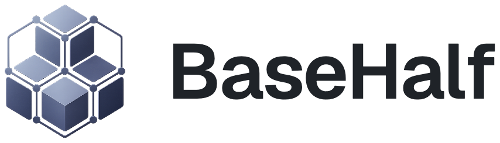
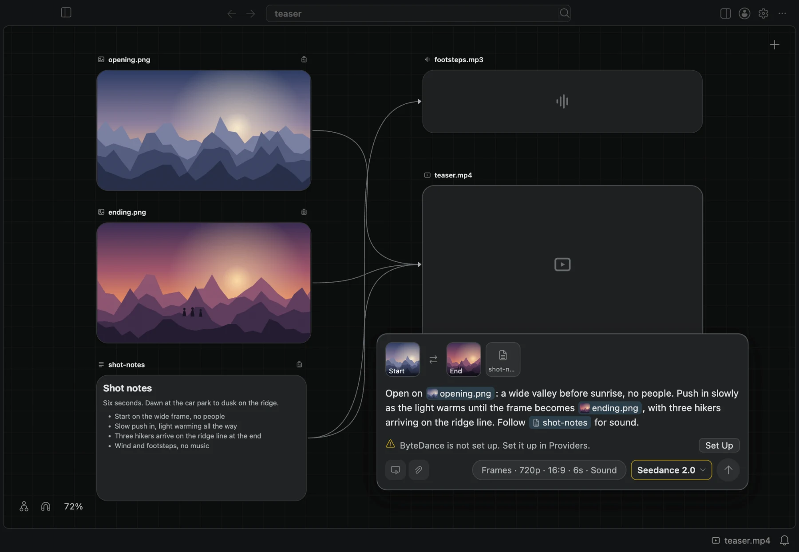
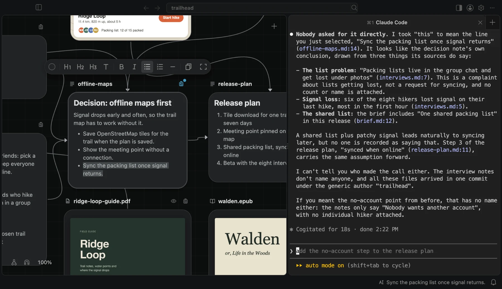

<h1 align="center">
  <picture>
    <source media="(prefers-color-scheme: dark)" srcset="docs/assets/readme/wordmark-dark.png">
    
  </picture>
</h1>

<p align="center">
  <strong>A visual thinking interface for you and your AI agents.</strong><br>
  Open a folder as a canvas. Use it as an AI whiteboard, a mind map, an AI notebook,<br>
  or a bring-your-own-key studio for AI video. Free and open source.
</p>

<p align="center">
  <a href="https://basehalf.com/download">Download for macOS</a> ·
  <a href="https://basehalf.com/docs/get-started">Get started</a> ·
  <a href="https://basehalf.com/docs">Docs</a> ·
  <a href="https://basehalf.com/blog">Blog</a> ·
  <a href="https://discord.gg/55wqkN9tPg">Discord</a> ·
  <a href="https://basehalf.com/zh">简体中文</a>
</p>

https://github.com/user-attachments/assets/7dffd9c3-ce69-46c7-8620-e0d23fa46eed

BaseHalf is a desktop app for thinking with AI on a canvas. Open a folder you
already have (a project, a course, a research topic, a film) and it becomes a
canvas. Every file is a card. A line between two cards says that one builds on
the other. The agents you already use, such as Claude Code and Codex, work
beside the canvas on the same files, and when you select a card and ask about
"this", they know what you mean.

It stays an ordinary folder on your computer. BaseHalf has no account and no
server of its own.

> **Half AI. Half human.** You draw the connections. AI follows them.

## What you can use it for

| Use it as | What you do |
| --- | --- |
| [**An AI whiteboard**](#an-ai-whiteboard) | Lay a problem out as cards, move them until the shape shows, then select the part an agent should look at, and ask. |
| [**A mind map**](#a-mind-map-your-agents-can-read) | Pull a line out of a note to grow the next one. Every node is a real note, and agents can follow the branches. |
| [**An AI notebook**](#an-ai-notebook) | Put papers, books, and your notes on one canvas. Ask about a passage, and get answers that name the note or the page they come from. |
| [**A BYOK studio for AI video**](#a-byok-studio-for-ai-video-images-and-sound) | Connect frames and shot notes to a draft and generate video, images, and sound with your own provider keys. Your agent can do it too. |
| [**A project workspace for agents**](#a-project-workspace-for-agents) | Keep decisions, plans, and code where every new agent session can read them, and stop explaining the project again. |

### An AI whiteboard

A vague complaint pasted into a chat gets a fluent answer to the wrong
question. On a whiteboard you do the cheap part first: put the scraps down as
cards, move them around until the shape shows, and name the question. Then
select only the cards that belong to it, and ask.

A card here is a file, not a sticky note. What you worked out is still in the
folder next month, where you and your agents can read it.

Ways to use it:
[unpack a fuzzy problem][blog-fuzzy] ·
[compare options side by side][blog-options] ·
[what you know, what you assume, what you still need][blog-know] ·
[observations and interpretations][blog-observations] ·
[the problem and the proposed solutions][blog-problem]

### A mind map your agents can read

Start from one note. Pull a line out of its edge and let go on empty canvas: a
new note appears, already connected. Keep going, make the cards small, and the
folder is a mind map. Tidy Canvas lays it out along its branches in one move.

A node holds one line or a whole page, because it is a real note. A branch is
saved as plain text in the note it leads to, so an agent can walk the map the
way you do, and tell you what a branch leaves out.

Read more:
[grow a connected note from any card][blog-branch] ·
[Tidy Canvas][blog-tidy] ·
[how connections work][docs-connections]

### An AI notebook

Put a paper, a book, and your own notes on one canvas. Open the paper, select a
passage, and ask your agent about "this". Or grow a note from the passage; the
note stays connected to its source.

To check that you understood, write your answer in a practice note, connect it
to what it draws on, and ask an agent to grade it. It reads the same cards and
sources you do, and tells you which card or page each point comes from.

Worked examples, each written from a real session:
[Transformers, from the paper *Attention Is All You Need*][blog-transformers] ·
[SQL joins][blog-sql] ·
[Git branching][blog-git] ·
[DNS][blog-dns] ·
[regular expressions][blog-regex] ·
[HTTP requests][blog-http] ·
[grow a note from a PDF or a book][blog-grow]

### A BYOK studio for AI video, images, and sound

<p align="center">
  
</p>

The storyboard is the request. Connect frames, clips, and shot notes to a draft
card, write the prompt, choose a model, and generate. What comes back is an
ordinary file on the canvas, ready to be connected into the next shot. Speech,
music, and sound effects are made the same way, and a video is trimmed where it
stands. Your agent can do all of it too: ask Claude Code or Codex to draft the
shots and generate them, with the same models and settings.

Bring your own keys (BYOK): BaseHalf works with 16 providers, among them
ByteDance (Seedance), Kling, Google, Runway, Luma, MiniMax, OpenAI, and
ElevenLabs. Requests go straight from your computer to the provider. BaseHalf
sells no credits and stands nowhere in between.

Read more:
[generate from what is on the canvas][blog-generate] ·
[trim a video][blog-trim] ·
[AI images, video and sound][docs-ai]

### A project workspace for agents

Keep the interviews, decisions, plans, designs, and code of a project in one
folder. Each note records what it was written from, so a new agent session
starts from the project and not from an empty chat. In the project on our home
page, Claude Code found a request from the interviews that the release plan had
left out, and the connections showed the step where it was lost.

Read more:
[project management is context management][blog-pm] ·
[a local folder is a better AI workspace than another chat][blog-folder] ·
[Claude Code and Codex in one window][blog-agents] ·
[what is worth keeping from a session][blog-compounds]

## How it works

**1. A folder is a canvas.** Open a folder and its files and subfolders are
cards: notes, images, video, sound, PDFs, books, and code, side by side. Read
and edit them where they are. A subfolder is a canvas of its own. Opening a
folder changes none of your files.

**2. A line means "this builds on that".** Draw a line from a card to a note,
and the note gets one more line of plain text that names the card. Git shows it
in a diff, and any agent that opens the note can read it. Where a card sits is
for your eyes only; a line is what stays.

**3. "This" means what you selected.** Select a card or a passage and ask.
BaseHalf records the selection where agents look, so "who asked for this?" is a
complete question.

<p align="center">
  
</p>

## What else it does

- **Notes that look like notes.** A note shows on its card as written, with
  tables, pictures, and task boxes. Edit it on the card, or open it full size.
  It stays a plain Markdown file.
- **PDFs and books on the canvas.** A PDF or an e-book is a card with its
  cover. It opens to be read, and agents can see the passage you select.
- **Tidy up in one move.** Line up a few selected cards, or let Tidy Canvas lay
  out the whole folder along its connections.
- **Undo puts it all back.** Deleting asks nothing, because one undo returns
  the files with their places, descriptions, and connections.
- **Files that move are followed.** Rename or move a file anywhere, even while
  BaseHalf is closed, and its card and its connections follow it.
- **Files, Git, and Search from VS Code.** Your branches and diffs work the way
  they always have.
- **Any agent that runs in a terminal.** Claude Code, Codex, OpenCode, or
  Gemini CLI, side by side, each in a session of its own.

## What it does not do

- **It is not an agent, and it contains none.** You bring the agents you
  already use. They are optional: the canvas works on its own.
- **It does not put your folder into a prompt.** Agents open the files they
  need, with their own tools.
- **It does not organize for you.** It does not group your cards or guess
  connections. A line is there because you drew it, or because an agent you
  asked did.
- **It does not take over your folder.** What the canvas knows about your
  files (where the cards are, their one-line descriptions) is kept in one
  hidden folder, `.bh/`, beside them. BaseHalf never edits your `.gitignore`,
  your `CLAUDE.md`, or your `AGENTS.md`, and it runs no background program.

## Install

BaseHalf runs on macOS on Apple Silicon.

1. Download the latest disk image from [basehalf.com/download][download] or
   from [GitHub Releases][latest-release].
2. Open it and drag BaseHalf into Applications.
3. The app is not notarized yet, so macOS may refuse to open it the first
   time. Run this once in a terminal, then start BaseHalf like any other app:

   ```bash
   xattr -dr com.apple.quarantine /Applications/BaseHalf.app
   ```

4. Open a folder. [Get started][docs-get-started] walks through the first
   canvas and the first connection.

To work with agents, install the ones you want, such as the Claude Code or
Codex command-line tools. When you open a folder, BaseHalf offers to install a
small skill that tells them how to read a canvas. It is added to the agents'
own settings, not to your folder.

BaseHalf updates itself. It is early and changes quickly; every release is
described on the [releases page][releases].

## Docs

- [Get started][docs-get-started]: download, first launch, and your first
  folder.
- [Canvas and cards][docs-canvas]: everything you can do with cards.
- [Connections][docs-connections]: what a line means and where it is kept.
- [Working with agents][docs-agents]: sessions, the skill, and selection.
- [AI images, video and sound][docs-ai]: drafts, inputs, providers, and keys.
- [Blog][blog]: worked examples, and notes on context, agents, and compound
  thinking.

## Community

- [GitHub Discussions][discussions]: questions and ideas.
- [Discord][discord]: chat.
- [X][twitter]: short progress notes.
- QQ groups for Chinese speakers: [users][qq-users] and
  [developers][qq-developers].

If you build something with BaseHalf, we would love to see it.

## Build from source

BaseHalf is built on the open-source code of VS Code. Files, Git, Search, and
the terminals are VS Code's; the canvas, the cards, and the agent sessions
beside them are BaseHalf's. The product's source is in `vscode-base/`, and it
needs macOS and the Node version in `vscode-base/.nvmrc`.

```bash
cd vscode-base
nvm use
npm install
npm run compile
./scripts/code.sh
```

Checks:

```bash
npm run typecheck-client
./scripts/test.sh
npm run basehalf:smoke
```

Where to read on:

- [Development harness](docs/harness/README.md): where to start for each kind
  of change.
- [Specifications](docs/specs/): how each part of BaseHalf has to behave.
- [Decisions](docs/decisions.md): why it is built this way.
- [Roadmap](docs/roadmap.md): what is being worked on.

## Contributing

BaseHalf is early and deliberately narrow. Bug reports and ideas are always
welcome. Before a pull request that is more than a small fix, please open an
issue or a discussion, so that we agree on the scope first.

[CONTRIBUTING.md][contributing] covers the contributor license agreement, the
licenses a dependency may have, and the rules a change has to keep. By taking
part you agree to our [Code of Conduct][code-of-conduct].

## License

BaseHalf is [Apache-2.0][license]. The parts in `vscode-base/` that come from
VS Code keep their MIT license and third-party notices.

Contributions require a signed [CLA][cla]. The "BaseHalf" name and logo are
trademarks of Pointa Labs, Inc. See the [trademark policy][trademark-policy].

[download]: https://basehalf.com/download
[latest-release]: https://github.com/Pointa-Labs/basehalf/releases/latest
[releases]: https://github.com/Pointa-Labs/basehalf/releases
[discussions]: https://github.com/Pointa-Labs/basehalf/discussions
[twitter]: https://x.com/JustJerry121
[discord]: https://discord.gg/55wqkN9tPg
[qq-users]: https://qm.qq.com/q/hNq8D39YPe
[qq-developers]: https://qm.qq.com/q/LTidm8fKCc
[contributing]: CONTRIBUTING.md
[cla]: CLA.md
[code-of-conduct]: CODE_OF_CONDUCT.md
[license]: LICENSE
[trademark-policy]: docs/trademark-policy.md

[docs-get-started]: https://basehalf.com/docs/get-started
[docs-canvas]: https://basehalf.com/docs/canvas-and-cards
[docs-connections]: https://basehalf.com/docs/connections
[docs-agents]: https://basehalf.com/docs/working-with-agents
[docs-ai]: https://basehalf.com/docs/ai-video
[blog]: https://basehalf.com/blog

[blog-transformers]: https://basehalf.com/blog/learn-transformers-with-basehalf
[blog-sql]: https://basehalf.com/blog/learn-sql-with-basehalf
[blog-git]: https://basehalf.com/blog/learn-git-branching-with-basehalf
[blog-dns]: https://basehalf.com/blog/learn-dns-with-basehalf
[blog-regex]: https://basehalf.com/blog/learn-regex-with-basehalf
[blog-http]: https://basehalf.com/blog/learn-http-requests-with-basehalf
[blog-grow]: https://basehalf.com/blog/grow-note-from-pdf-or-book
[blog-fuzzy]: https://basehalf.com/blog/unpack-fuzzy-problem-on-canvas
[blog-options]: https://basehalf.com/blog/compare-options-on-canvas-before-ai
[blog-know]: https://basehalf.com/blog/lay-out-know-assume-need-before-you-ask
[blog-observations]: https://basehalf.com/blog/separate-observations-from-interpretations
[blog-problem]: https://basehalf.com/blog/separate-problem-from-proposed-solutions
[blog-pm]: https://basehalf.com/blog/project-management-is-context-management
[blog-folder]: https://basehalf.com/blog/local-folder-ai-workspace
[blog-agents]: https://basehalf.com/blog/claude-code-codex-agent-area
[blog-compounds]: https://basehalf.com/blog/what-compounds-in-thinking
[blog-generate]: https://basehalf.com/blog/generate-from-the-canvas
[blog-trim]: https://basehalf.com/blog/trim-a-video-in-card-detail
[blog-branch]: https://basehalf.com/blog/create-connected-note-from-canvas-drop
[blog-tidy]: https://basehalf.com/blog/tidy-canvas-along-connections
